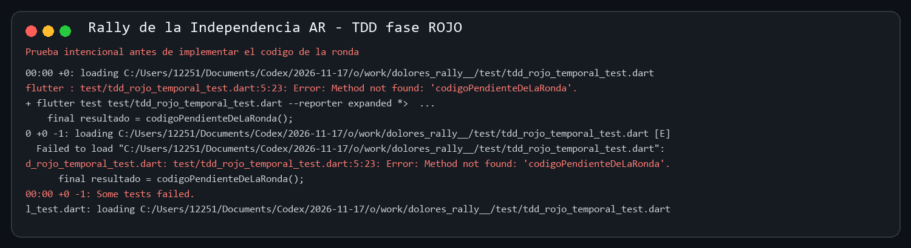
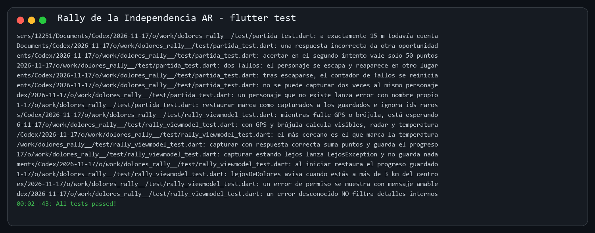

# Rally de la Independencia AR

Juego móvil en Flutter que combina geolocalización, brújula, realidad aumentada y preguntas sobre la Independencia de México en Dolores Hidalgo.

## Ejecutar

```bash
flutter pub get
flutter test
flutter run
```

Consulta [LEEME.md](LEEME.md) para conocer el modo demo y los requisitos por plataforma.

## Evidencia de pruebas

La suite verifica geografía, apariciones, radar, motor AR, captura de personajes, puntuación, persistencia y ViewModel. Resultado: **43 pruebas aprobadas**.

### Ciclo TDD: rojo a verde

La captura roja reproduce de forma controlada el momento previo a implementar una regla; la verde corresponde a la suite final del repositorio.

| 🔴 Prueba que solicita código faltante | 🟢 Implementación terminada |
|---|---|
|  |  |

A new Flutter project.

## Getting Started

This project is a starting point for a Flutter application.

A few resources to get you started if this is your first Flutter project:

- [Learn Flutter](https://docs.flutter.dev/get-started/learn-flutter)
- [Write your first Flutter app](https://docs.flutter.dev/get-started/codelab)
- [Flutter learning resources](https://docs.flutter.dev/reference/learning-resources)

For help getting started with Flutter development, view the
[online documentation](https://docs.flutter.dev/), which offers tutorials,
samples, guidance on mobile development, and a full API reference.
