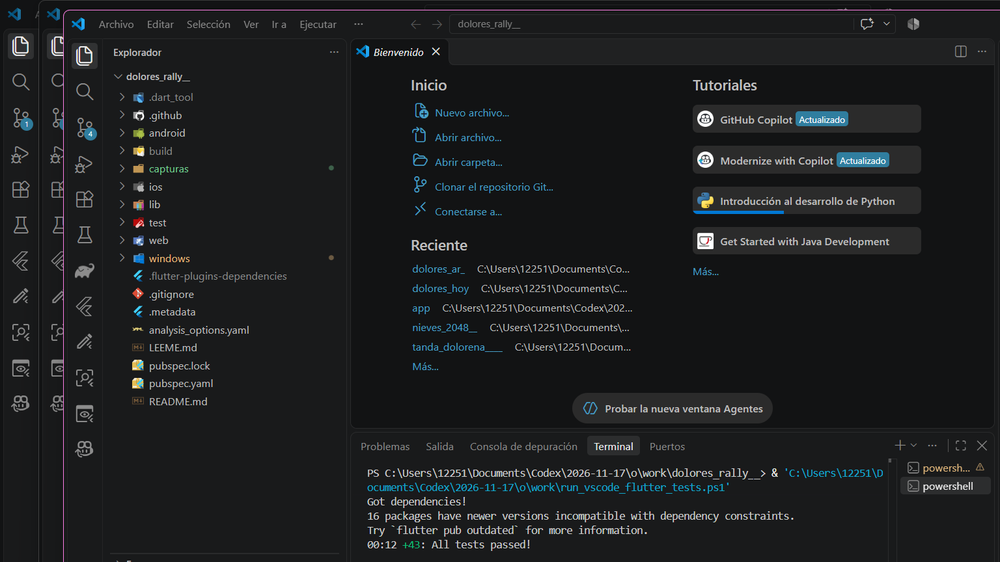

# Rally de la Independencia AR

Este proyecto es un juego hecho en Flutter. Usa ubicación, brújula, radar y preguntas sobre la Independencia de México en Dolores Hidalgo.

El jugador busca personajes, se acerca a ellos y responde una pregunta para capturarlos. También guarda el puntaje y el avance.

## Cómo ejecutarlo

```bash
flutter pub get
flutter run
```

Para ejecutar las pruebas:

```bash
flutter test
```

El archivo [LEEME.md](LEEME.md) explica el modo de demostración.

## Todas las pruebas

Se ejecutaron las siguientes 43 pruebas:

1. Genera una aparición por personaje.
2. Caminar 100 metros al norte conserva la distancia y el rumbo.
3. La ida y vuelta conserva distancia y rumbo en cualquier dirección.
4. Todas las apariciones quedan entre el radio mínimo y máximo.
5. La misma semilla repite los mismos resultados.
6. Caminar cero metros deja el punto en el mismo lugar.
7. Semillas distintas generan lugares distintos.
8. Un grado de latitud mide aproximadamente 111.2 kilómetros.
9. Los puntos se reparten en todas las direcciones.
10. La diferencia angular cruza el norte por el camino corto.
11. Suavizar un ángulo funciona al pasar de 350 a 10 grados.
12. La posición horizontal reconoce centro, borde y fuera de campo.
13. Un personaje al frente aparece en el centro.
14. Un personaje a 90 grados no aparece hasta girar hacia él.
15. La vista funciona al cruzar el norte entre 350 y 5 grados.
16. Los personajes lejanos se dibujan primero y más pequeños.
17. Los personajes fuera del radio máximo se descartan.
18. Una respuesta correcta y cercana captura con 100 puntos.
19. Si el jugador está lejos no puede intentar la captura.
20. Estar exactamente a 15 metros todavía permite capturar.
21. Una respuesta incorrecta permite otro intento.
22. Acertar en el segundo intento entrega 50 puntos.
23. Después de dos fallos el personaje escapa y reaparece.
24. Al escapar se reinicia el contador de fallos.
25. Un personaje no se puede capturar dos veces.
26. Un personaje inexistente produce un error claro.
27. Restaurar el progreso ignora identificadores desconocidos.
28. Un punto al norte aparece arriba del radar.
29. Un punto al este aparece a la derecha del radar.
30. Al girar al este el mismo punto aparece arriba.
31. Un punto al sur aparece abajo del radar.
32. Un punto fuera del alcance no aparece.
33. La temperatura por distancia respeta sus límites.
34. Al alejarse la señal nunca se vuelve más caliente.
35. Sin GPS o brújula la aplicación queda esperando.
36. Con GPS y brújula se calculan vista, radar y temperatura.
37. El personaje más cercano determina la temperatura.
38. Capturar correctamente suma puntos y guarda el avance.
39. Intentar una captura desde lejos no guarda cambios.
40. Al iniciar se restaura el progreso guardado.
41. La aplicación avisa al estar a más de tres kilómetros de Dolores.
42. Un problema de permisos muestra un mensaje sencillo.
43. Un error desconocido no muestra información interna.

Resultado final: **43 pruebas aprobadas**.

## Capturas reales de las pruebas

La primera captura muestra la fase roja con una función faltante. La segunda muestra la suite completa terminada correctamente.

### Fase roja


### Fase verde


