# Rally de la Independencia AR

Aplicación de un rally en Dolores Hidalgo con ubicación, radar, preguntas, álbum y modo de demostración.

## Cómo ejecutar

1. Instalar las dependencias con `flutter pub get`.
2. Ejecutar las pruebas con `flutter test`.
3. Abrir la aplicación con `flutter run`.

## Trabajo con TDD

En cada fase se siguió el ciclo rojo y verde. La captura roja muestra el error real producido antes de completar el código faltante. La captura verde muestra en Visual Studio Code el código usado para resolver esa fase.

## Fase 0. Preparar el taller

### Fase roja

En esta parte la prueba todavía falla porque falta implementar el código de la fase.

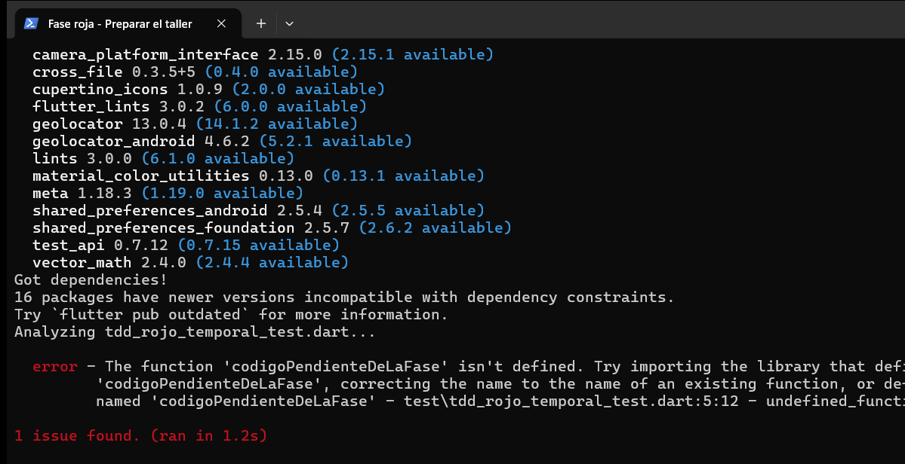

### Fase verde

Después se agrega el código necesario para resolver la prueba y continuar con el proyecto.

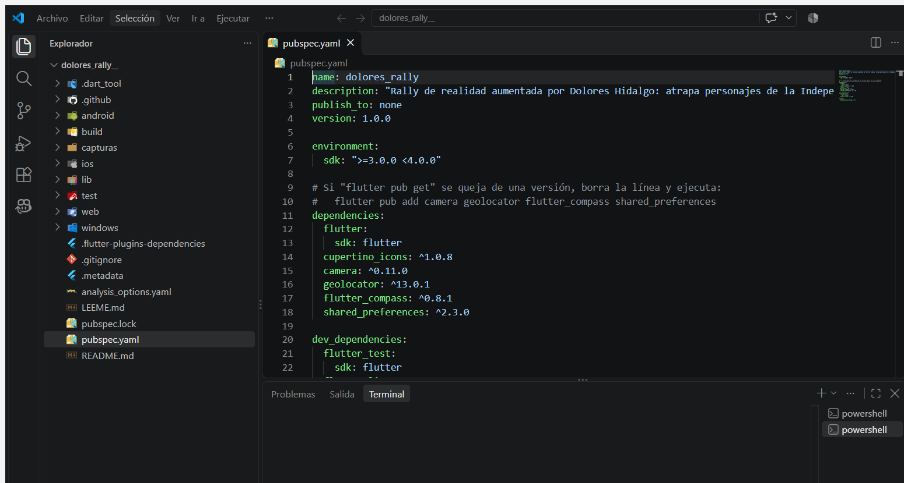

## Fase 1. Diseñar el juego

### Fase roja

En esta parte la prueba todavía falla porque falta implementar el código de la fase.

### Fase verde

Después se agrega el código necesario para resolver la prueba y continuar con el proyecto.

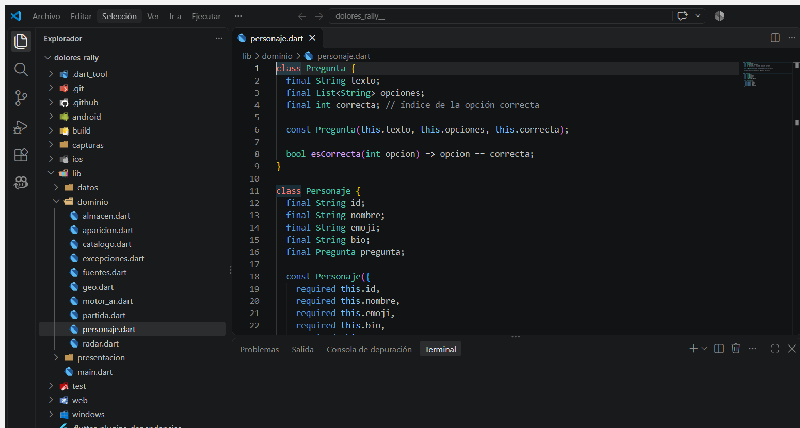

## Fase 2. Geometría de la Tierra

### Fase roja

En esta parte la prueba todavía falla porque falta implementar el código de la fase.

### Fase verde

Después se agrega el código necesario para resolver la prueba y continuar con el proyecto.

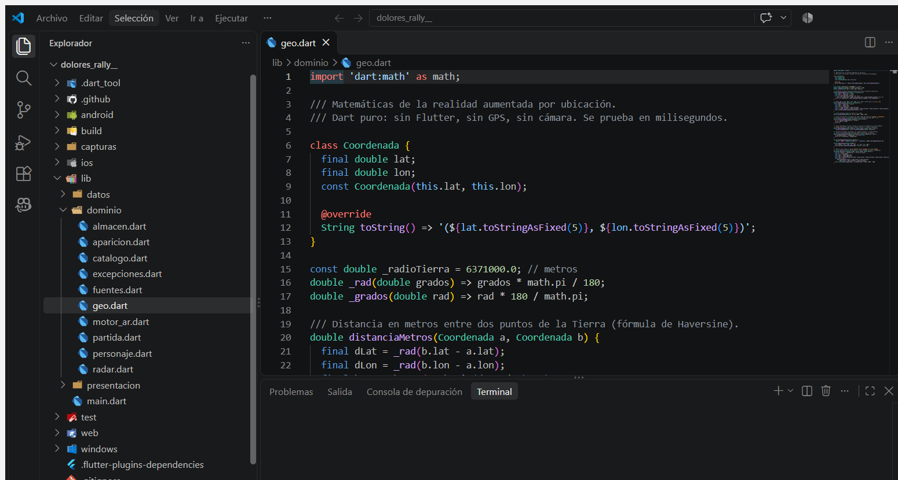

## Fase 3. Personajes y preguntas

### Fase roja

En esta parte la prueba todavía falla porque falta implementar el código de la fase.

### Fase verde

Después se agrega el código necesario para resolver la prueba y continuar con el proyecto.

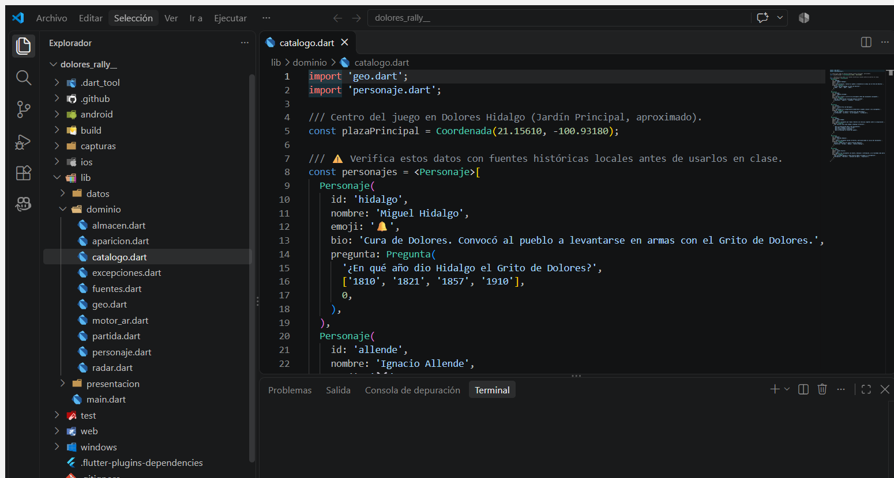

## Fase 4. Apariciones con azar controlado

### Fase roja

En esta parte la prueba todavía falla porque falta implementar el código de la fase.

### Fase verde

Después se agrega el código necesario para resolver la prueba y continuar con el proyecto.

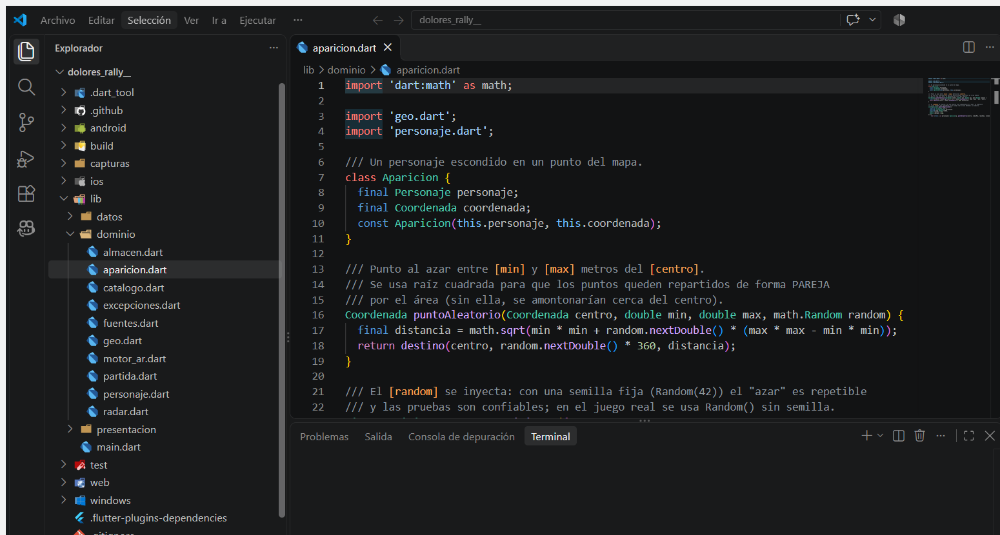

## Fase 5. Radar y frío o caliente

### Fase roja

En esta parte la prueba todavía falla porque falta implementar el código de la fase.

### Fase verde

Después se agrega el código necesario para resolver la prueba y continuar con el proyecto.

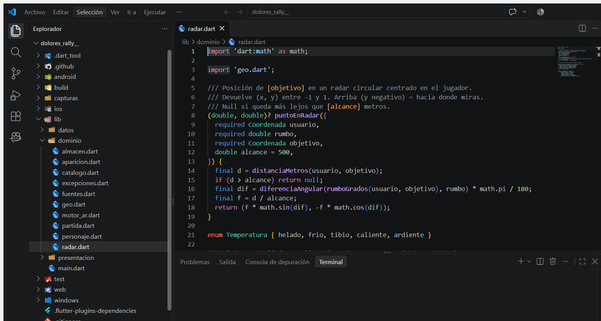

## Fase 6. Motor de realidad aumentada

### Fase roja

En esta parte la prueba todavía falla porque falta implementar el código de la fase.

### Fase verde

Después se agrega el código necesario para resolver la prueba y continuar con el proyecto.

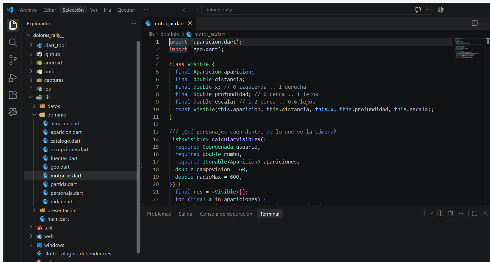

## Fase 7. Reglas del juego

### Fase roja

En esta parte la prueba todavía falla porque falta implementar el código de la fase.

### Fase verde

Después se agrega el código necesario para resolver la prueba y continuar con el proyecto.

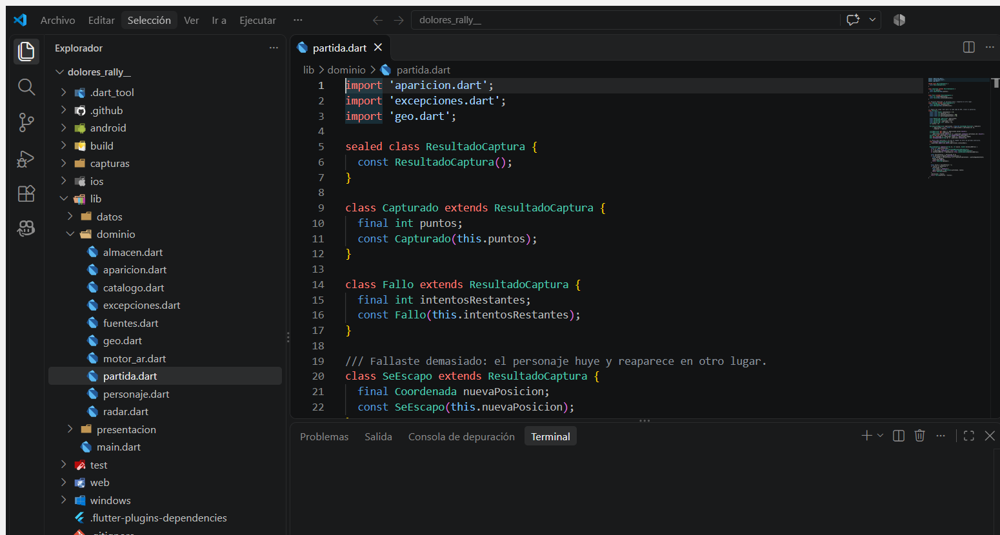

## Fase 8. Guardar el progreso

### Fase roja

En esta parte la prueba todavía falla porque falta implementar el código de la fase.

### Fase verde

Después se agrega el código necesario para resolver la prueba y continuar con el proyecto.

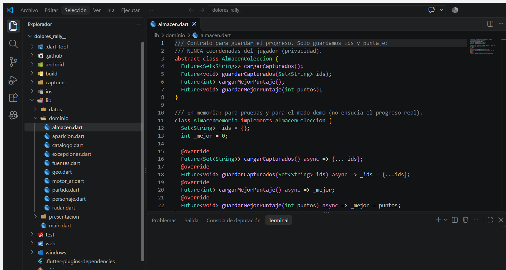

## Fase 9. Fuentes de posición y brújula

### Fase roja

En esta parte la prueba todavía falla porque falta implementar el código de la fase.

### Fase verde

Después se agrega el código necesario para resolver la prueba y continuar con el proyecto.

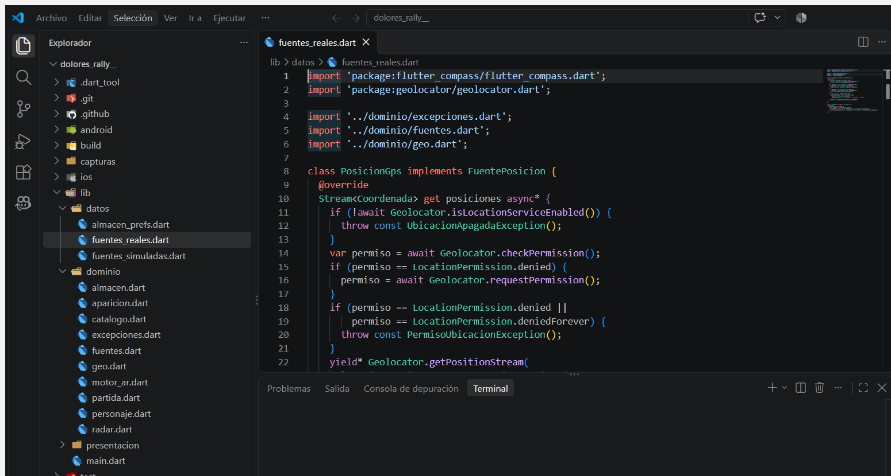

## Fase 10. ViewModel del juego

### Fase roja

En esta parte la prueba todavía falla porque falta implementar el código de la fase.

### Fase verde

Después se agrega el código necesario para resolver la prueba y continuar con el proyecto.

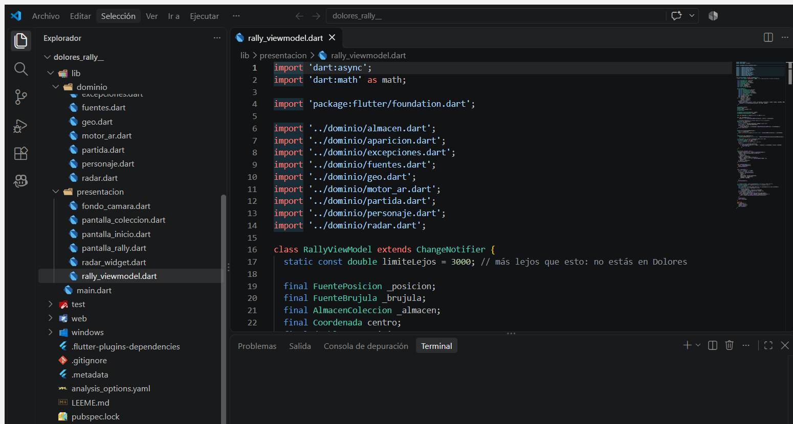

## Fase 11. Pantallas

### Fase roja

En esta parte la prueba todavía falla porque falta implementar el código de la fase.

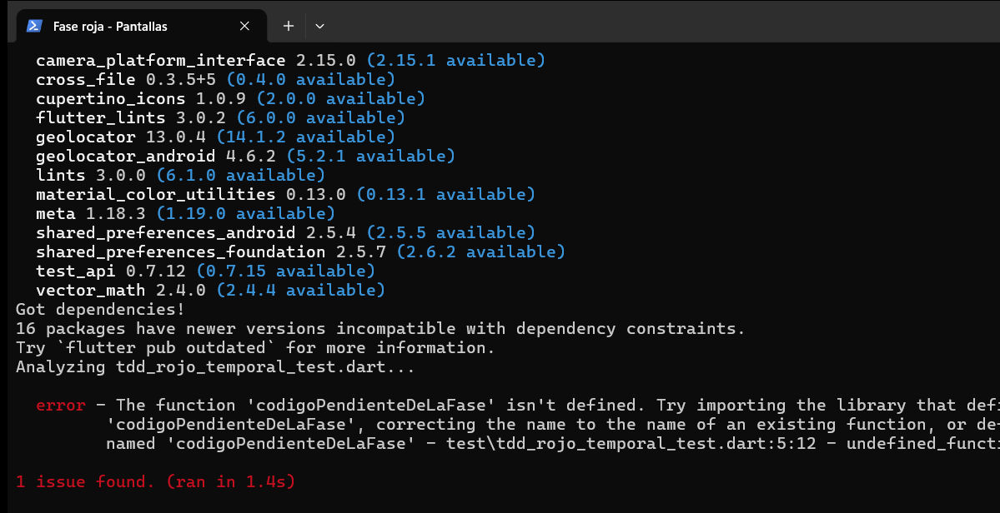

### Fase verde

Después se agrega el código necesario para resolver la prueba y continuar con el proyecto.

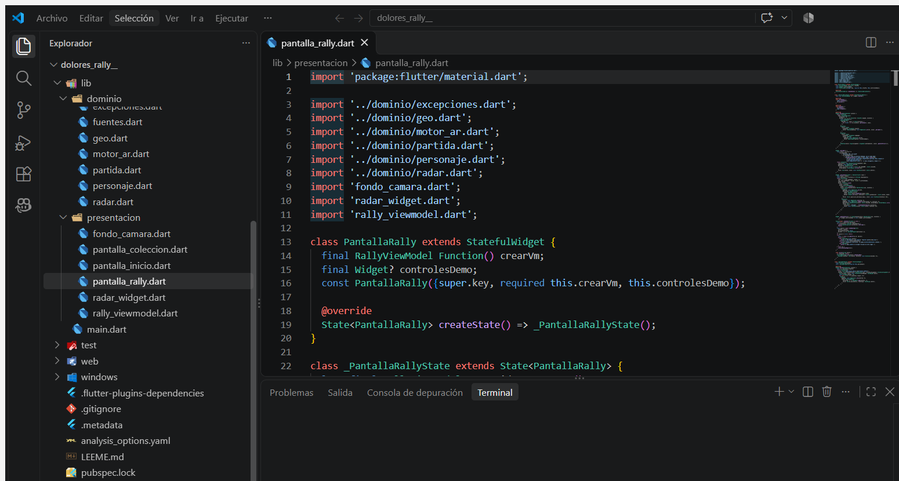

## Fase 12. Prueba de campo y seguridad

### Fase roja

En esta parte la prueba todavía falla porque falta implementar el código de la fase.

### Fase verde

Después se agrega el código necesario para resolver la prueba y continuar con el proyecto.

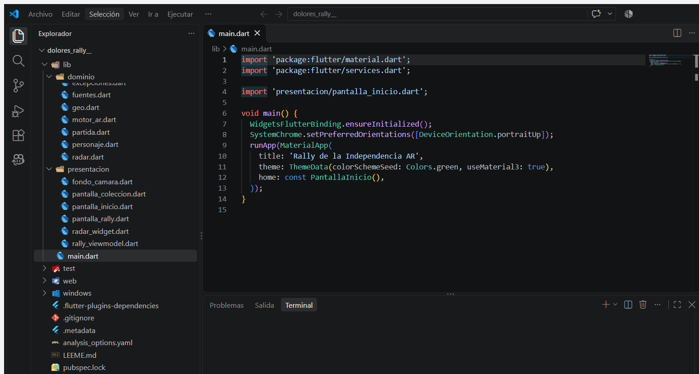

## Aplicación completa

Esta es la aplicación ejecutándose después de terminar las fases.

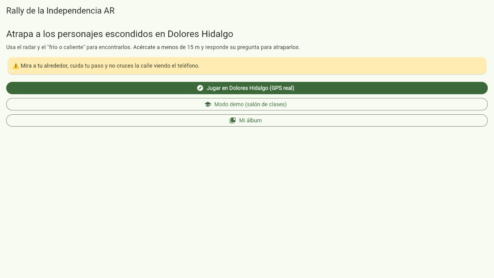

## Resultado

Las fases quedaron documentadas una por una. Cada fase conserva su evidencia roja y verde, y al final se muestra el resultado completo de la aplicación.

